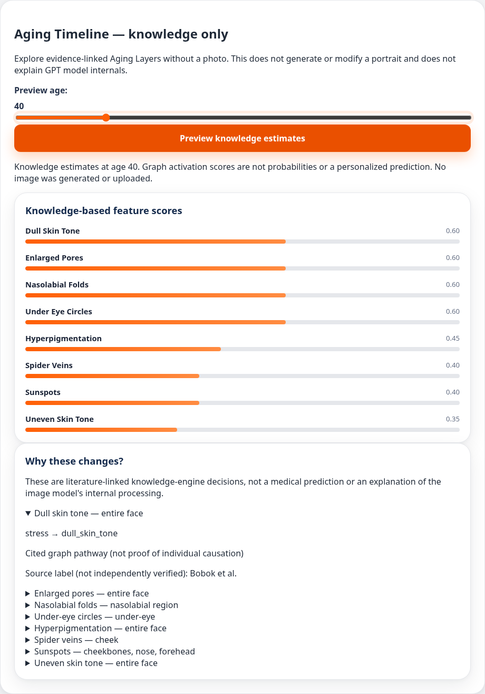

# Aging Timeline and Aging Layers

The knowledge-only preview works without a portrait or OpenAI/Box credentials.
From the existing checkout, install `requirements.txt` and `pytest httpx`, run
`python -m uvicorn api.main:app --port 8000`, and serve `docs` with
`python -m http.server 8001 --directory docs`. Use the existing isolated checkout;
no additional worktree is needed.

`POST /api/timeline` accepts JSON:

```json
{"profile":{"age":20,"target_age":65,"sex":"male","ethnicity":"Asian","factors":{"smoking":0.4}},"stages":4}
```

The response has `mode: "knowledge_only"`, current/target ages, a disclaimer,
and snapshots containing `age`, `aging_representation`, and `feature_traces`.
Stages must be an integer from 1 to 12; rounded duplicate ages are collapsed.
All stages exceed the current age and the final stage is the target age.
Bad profiles return 400; an unavailable engine returns 503. No image, study
participant ID, rendering call, or storage operation is part of this endpoint.

The slider requests one snapshot for its selected age, debounces input, aborts
superseded requests, and rejects stale responses. It updates feature scores and
Layers only. Portrait generation still uses the separate form target age;
the generated portrait keeps its own age label when the slider moves. Research
feedback remains tied to the actual stored generation, never a preview.

## Evidence limitations

Scores are deterministic graph activations, not calibrated probabilities,
medical predictions, or an explanation of GPT image-model internals. The engine
uses age eligibility and a normalized intrinsic-aging activation; some lifestyle
scores remain constant across ages and scores need not grow monotonically.

Traces follow positive recorded contributions and exact edge indices; ambiguous
legacy duplicate edges are omitted. Traversal is limited to four hops and five
paths per feature. The UI shows the top eight positive features and up to three
paths each, so the view is a bounded selection, not an exhaustive evidence audit.
Empty/placeholder citations and provisional hypotheses are labelled as incomplete.
A source label marks a graph citation, not independent verification of the paper;
only existing DOI identifiers become links. Missing bibliographic metadata is not
invented. A wholly missing active path is explicitly reported.

Existing consent UI behavior (including its pre-IRB disabled modal), Box storage,
local synthetic-test exceptions, and IRB approval gates are preserved. This change
does not authorize participant collection or fix the separate consent/protocol
reconciliation described in `box_study_storage.md`. No deployment was changed.

## Validation

```sh
PYTHONDONTWRITEBYTECODE=1 python -m pytest -q -p no:cacheprovider tests
node --check docs/app.js
```

For the browser check, make Playwright and Chromium available, serve docs on
8001 and start the backend on 8002, then run:

```sh
node tests/frontend/timeline.cjs
```

`CHROMIUM_PATH` overrides `/usr/bin/chromium`. The browser forwards preview
requests to the real local API, mocks explicit portrait generation with a
one-pixel synthetic PNG, and never contacts OpenAI or Box. It checks age-dependent
scores/Layers, no-photo preview, immutable portrait, disabled unstored feedback,
latest-age behavior, preview errors, mobile overflow, and browser errors.
The screenshot is captured before uploading even the synthetic test pixel.


