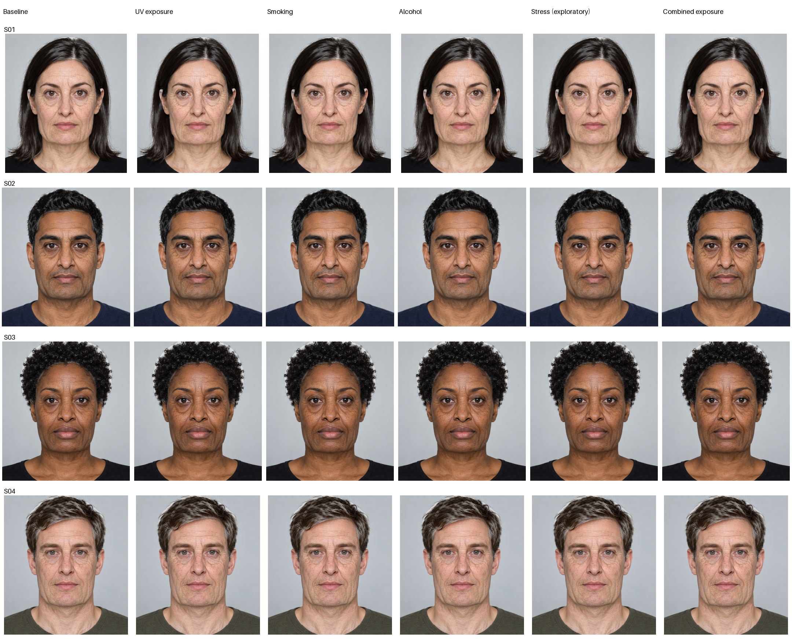

# Lifestyle scenarios v0.1

The v0.4 local demo compares the **same input and same target age** with baseline,
UV, smoking, alcohol, exploratory stress, combined UV/smoking/alcohol or custom
0–1 modifiers. These are illustrative added modifiers, not exposure doses,
pack-years, sun hours, probability, a clinical prediction or a healthy-person
counterfactual. Baseline still ages. No source graph/data-collection file changes.

## How to use

Launch with the existing isolated environment:

```bash
python -m experiments.geometry_renderer.launch
```

Select a fictional test portrait or local portrait. In **Lifestyle scenarios**,
select **Scenario**, then **Compare baseline at the same age**. Custom enables four
individual sliders; preset sliders show the applied values. Changing lifestyle
reuses the current age/quality model proposal, face detection and semantic masks.
The two most recent compositions are cached in session memory. Changing age or
quality invalidates compositions; Clear releases all retained photo references.
No portrait is automatically written or sent to the research/Box pipeline.

## Routing and evidence

| Factor | Selected visual routes | Limits |
|---|---|---|
| UV | Forehead/outer-eye skin residual, exposed-face relief, pigmentation/sunspots, dryness, modest lower-face laxity | Regional distribution and coefficients are authored; not a UV dose-response model. |
| Smoking | Mouth-centered facial-wrinkle residual, outer-eye/nasolabial cues, dryness/uneven tone, modest lower-face laxity | Mouth localization uses the graph's generic `facial_wrinkles`, not a fabricated perioral-line citation. |
| Alcohol | Existing dryness, cheek-puffiness, redness/capillary proxies | Mild visual cues; no diagnosis of drinking or disease from appearance. |
| Stress | Existing under-eye-circle, dullness, dryness and pore proxies | Exploratory, low gains; does not generate graying or hair loss. |
| Diet | No image changes | Generic diet input cannot establish a vitamin deficiency; no deficit appearance is inferred. |

A route must be explicitly allowlisted in `lifestyle.py` **and** have an eligible
existing source-root path at the target age. Missing features do not borrow
citations. Paths retain each edge's original reference, missing-citation and
provisional flags. Even complete repository labels remain unverified. The UI's
**Lifestyle effects and source evidence** panel shows these paths, region,
requested gain, feature/layer enabled status, and limits. Requested controls are
not pixel-verified neural feature attribution or a model-internals explanation.

Individual gains range from10–35% of the existing age-feature intensity. Multiple
factors add only to a35% per-feature cap; shared aliases use existing max-based
operators. No empirical interaction or exposure-history model is claimed. Feature
and mechanism controls remain effective, as do layer toggles and same-age identity.

The learned proposal is conditioned only on source/target age. Baseline blending
uses an exposure-independent normalization. Local lifestyle gains subsequently
modulate the existing residual in authored regions; they do not draw new wrinkle
paths or rerun/condition the network. Explicit surface/geometry operators use
scenario-adjusted scores. This avoids normalizing an exposure increase away or
weakening unrelated areas when another area's exposure rises.

## Validation and practical limits

- 156 experiment tests and3 existing API tests passed. New tests cover eligible
  routing, unchanged hair/missing features, absent diet effects, bounded combined
  gains, missing citations, distinct regional gains, same-age/layer identity,
  two-composition reuse, proposal invalidation, Clear and UI preset/custom values.
- Real Chromium checks UV/smoking same-age comparisons using one shared neural
  proposal, plus wipe/reset/clear and zero external requests/browser errors.
- Four manifest-pinned **fictional adult inputs**, target30→75, ultra quality and
  identical controls: baseline plus5 scenarios per input (24 outputs). All20
  scenario renders differ from baseline and all safety scales are1.0. Diet is
  pixel-exact baseline. Each input is detected/parsed once; cached verified
  fixture proposals are reused. No participant images or aged image-generation
  outputs are involved.
- Recorded scenario composition: **0.44–0.60s** on cloud CPU, excluding age inference,
  detection/parsing and browser display. This is not first-render latency, an
  RTX4060/laptop measurement or a20-second guarantee.
- Three no-modifier outputs exactly match the previous revision. S01 differs at
  one pixel by at most2 RGB levels; all raw deltas are recorded. No meaningful
  visual baseline change was observed.



UV/smoking/combined differences are more apparent; alcohol/stress are intentionally
subtle at this uncalibrated gain setting. Pixel differences establish execution,
not naturalness, exact perceived age or causation. Existing papery skin, tired-eye,
hair/mask and identity limitations remain. No perceptual or demographic study.

Reproduce the explicit fictional-fixture diagnostic (writes outputs only here):

```bash
AVATAR_SYNTHETIC_CACHE=/tmp/avatar-synthetic-cache python -m experiments.geometry_renderer.validate_lifestyle
python -m pytest experiments/geometry_renderer/tests -q
```

[Report](validation/lifestyle_v01/report.json) records source/input digests,
cache usage, per-scenario timings/differences, preparation counts and mesh safety.
[Actual UI](screenshots/lifestyle-scenarios-ui.png) shows a same-age comparison.
