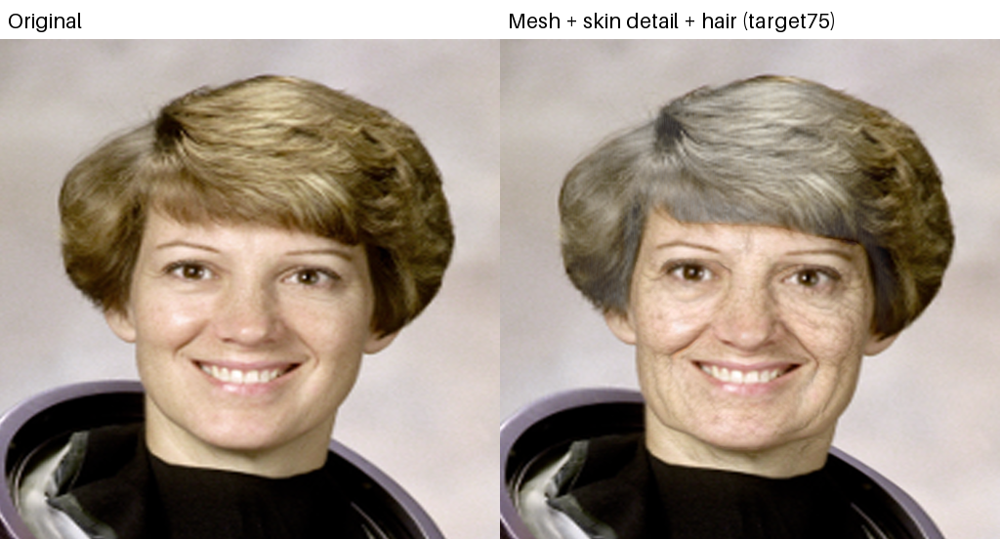

# AVATAR mesh-first local aging v0.2

Local CPU prototype: repository knowledge graph + explicit age baseline, fixed-border
mesh geometry, optional age-conditioned skin residual, and segmented hair graying.
**Illustrative appearance, not a calibrated prediction of the individual or exact age.**
Fast-AgingGAN was tested and rejected on visual quality. The selected optional skin
provider is an independently MIT-licensed FRAN-style reimplementation, not Disney's
official model. It produces skin detail; mesh remains the explicit geometry path.
No photos are uploaded, automatically saved, or connected to the research/Box API.

## Install / launch

Use Python 3.11 in a separate environment. From the repository root on Linux:

```bash
python3.11 -m venv experiments/geometry_renderer/.venv
experiments/geometry_renderer/.venv/bin/python -m pip install -r experiments/geometry_renderer/requirements-linux-py311.lock
experiments/geometry_renderer/.venv/bin/python -m experiments.geometry_renderer.prepare_models
experiments/geometry_renderer/.venv/bin/python -m experiments.geometry_renderer.launch
```

Windows PowerShell (suitable starting point for the user's HP OMEN11 / RTX4060;
Windows execution and that actual laptop have not been measured here):

```powershell
py -3.11 -m venv experiments/geometry_renderer/.venv
.\experiments\geometry_renderer\.venv\Scripts\python.exe -m pip install -r experiments/geometry_renderer/requirements.txt
.\experiments\geometry_renderer\.venv\Scripts\python.exe -m experiments.geometry_renderer.prepare_models
.\experiments\geometry_renderer\.venv\Scripts\python.exe -m experiments.geometry_renderer.launch
```

Setup downloads two public model assets (~177 MB total) once to ignored `.models/`,
checks their pinned SHA256 and preserves existing mismatching files. Rendering is
offline. No tokens, CUDA, Torch or GPU runtime are needed. The RTX4060 is **not**
automatically used: the packaged OpenCV DNN backend is CPU, normally four threads.
The launcher binds only to loopback, disables telemetry, and caps input at10MiB.
`--port` and `--threads` override local defaults.

Select the public-domain NASA sample or a local JPEG/PNG; current age30 and target75
are demonstration defaults, not estimates of the sample subject's age. Compare
all layers, disable skin/hair independently, inspect semantic masks, or use wipe
and diagnostic difference views. Equal ages are pixel-exact identity in working
resolution. Clear releases session references, not secure memory erasure.

## Pipeline and evidence

- `age_plan.py` reads existing v03 CSVs and records their SHA256. Seventeen feature
  curves and an exported19-node/18-edge `local.*` graph overlay add normal aging,
  missing hair/eye/neck/volume cues. All new edges/curves are **provisional visual
  mappings**, not physiological causal estimates. Zero lifestyle factors still age.
- `core.py` applies authored nose, cheek and jowl fields with fixed boundaries and
  positive triangle-area checks. Scores already contain the age delta, avoiding
  double age scaling.
- `conditional_skin.py` applies source/target-conditioned local skin residuals,
  with single512 or four-window768 quality. Semantic skin masks protect eyes,
  lips, brows and background; source chroma is preserved. The default learned
  path **never invokes hand-authored crease curves**. Individual KG feature scores
  are requests/reference context, not an explanation of neural internals or proof
  that each requested feature was synthesized.
- `hair_layers.py` parses source skin/hair/neck once using a verified local model;
  a mirrored pass reduces left/right parsing bias. Gray blending retains source
  strand texture. Masks can still miss hair or have uneven boundaries; inspect them.
- `session.py` caches detection/masks per image and appearance per age/quality;
  comparison controls reuse the last result. Small faces are upsampled toward300px
  face height, bounded by1536px canvas. This adds rasterization space, not recovered
  original detail. No global photo cache or photo files are written.

Skin's normal/height-field procedural fallback is retained only as a diagnostic;
it was not convincing elderly appearance by itself and is not the product default.
No production graph, API, consent, IRB, Box or deployment files are changed.

## Verification and your 20-second gate

```bash
python -m pytest experiments/geometry_renderer/tests -q
python -m experiments.geometry_renderer.benchmark_aging --quality detail --iterations 3 --output laptop-benchmark.json
```

The benchmark includes fresh-process imports, first-photo detection, parsing,
conditional inference and compositing. New-age timing includes rerunning the
conditioned model; inspection-cache timing is separate. Exit status2 means the
20-second budget failed. Downloads/install and browser display are excluded;
OS file cache may be warm. Run this on the **actual laptop** before accepting its
20-second contract. Choose `--quality fast` or disable skin if it fails.

Current cloud CPU evidence is in `benchmarks/local-aging-detail.json`: AMD EPYC9V74,
5 logical CPUs visible/4-CPU quota, four OpenCV threads, no GPU. This measurement
is not a claim of HP/RTX execution. UI also warns when measured photo processing
exceeds20seconds. Input validation, exact identity, masks, model hashes, source
protection, graph overlays, caching and real offline model calls have tests.

The licensed sample is visually more elderly, with distributed skin relief rather
than drawn lines; it does not certify target75. Identity, papery skin artifacts,
demographic/model biases and uneven gray-hair masks remain limitations. No broad
human age-perception study or clinical validation has been performed.

## Research / provenance

[Repository comparison](REPOSITORY_RESEARCH.md) covers Fast-AgingGAN, FRAN,
3DDFA_V2, DECA, EMOCA, FLAME and FaceScape, including asset/license/CPU limits.
[Third-party notices](THIRD_PARTY.md) and `models/*.json` record asset hashes,
MIT author/release provenance, preprocessing and training-data limitations.
The FRAN model is a124MB public ONNX conversion; no GPL FaceStudio code is used.
[Fixture provenance](tests/fixtures/README.md): NASA public-domain image only,
never participant photos. Tests/screenshots explicitly use that fixture.



Latest verification: **114 experiment tests passed**, plus3 existing API tests.
On the recorded cloud CPU the mirrored-parser/detail run took **8.878s** for the
first photo and **7.283s** for the next target age; the20-second gate passed.
The real-browser smoke checks full rendering, wipe, identity reset, clear, no
browser exceptions and no external browser requests. These are engineering and
licensed-fixture visual checks, not laptop measurements or an age-accuracy score.
