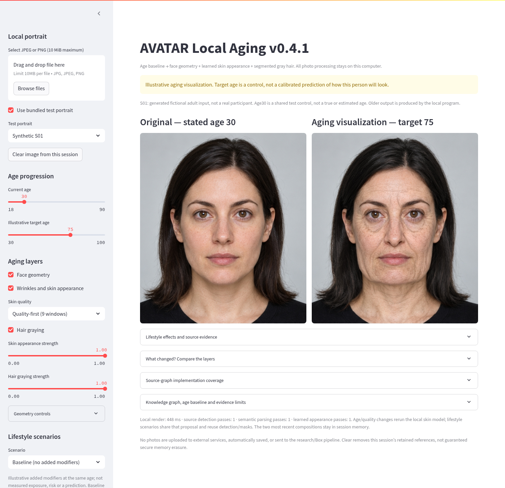

# AVATAR mesh-first local aging v0.4.1

Local CPU prototype: repository knowledge graph + explicit age baseline, fixed-border
mesh geometry, optional age-conditioned skin residual, and segmented hair graying.
**Illustrative appearance, not a calibrated prediction of the individual or exact age.**
Fast-AgingGAN was tested and rejected on visual quality. The selected optional skin
provider is an independently MIT-licensed FRAN-style reimplementation, not Disney's
official model. It produces skin detail; mesh remains the explicit geometry path.
No photos are uploaded, automatically saved, or connected to the research/Box API.

## Install / launch

Use Python 3.11 in a separate environment. From the repository root on Linux:

```bash
python3.11 -m venv experiments/geometry_renderer/.venv
experiments/geometry_renderer/.venv/bin/python -m pip install -r experiments/geometry_renderer/requirements-linux-py311.lock
experiments/geometry_renderer/.venv/bin/python -m experiments.geometry_renderer.prepare_models
experiments/geometry_renderer/.venv/bin/python -m experiments.geometry_renderer.launch
```

Windows PowerShell (suitable starting point for the user's HP OMEN11 / RTX4060;
Windows execution and that actual laptop have not been measured here):

```powershell
py -3.11 -m venv experiments/geometry_renderer/.venv
.\experiments\geometry_renderer\.venv\Scripts\python.exe -m pip install -r experiments/geometry_renderer/requirements.txt
.\experiments\geometry_renderer\.venv\Scripts\python.exe -m experiments.geometry_renderer.prepare_models
.\experiments\geometry_renderer\.venv\Scripts\python.exe -m experiments.geometry_renderer.launch
```

Setup downloads two public model assets (~177 MB total) once to ignored `.models/`,
checks their pinned SHA256 and preserves existing mismatching files. Rendering is
offline. No tokens, CUDA, Torch or GPU runtime are needed. The RTX4060 is **not**
automatically used: the packaged OpenCV DNN backend is CPU, normally four threads.
The launcher binds only to loopback, disables telemetry, and caps input at10MiB.
`--port` and `--threads` override local defaults.

Select a generated fictional test portrait, the NASA reference, or a local JPEG/PNG; current age30 and target75
are demonstration defaults, not estimates of the sample subject's age. Compare
all layers, disable skin/hair independently, inspect semantic masks, or use wipe
and diagnostic difference views. Equal ages are pixel-exact identity in working
resolution. Clear releases session references, not secure memory erasure.

## Pipeline and evidence

- `age_plan.py` reads existing v03 CSVs and records their SHA256. Curated feature
  curves and an exported namespaced `local.*` graph overlay add normal aging,
  missing hair/eye/neck/volume cues. All new edges/curves are **provisional visual
  mappings**, not physiological causal estimates. Zero lifestyle factors still age.
- `core.py` applies authored nose, cheek and jowl fields with fixed boundaries and
  positive triangle-area checks. Scores already contain the age delta, avoiding
  double age scaling.
- `conditional_skin.py` applies source/target-conditioned local skin residuals,
  with single512, four-window768 or quality-first nine-window1024 rendering. Semantic skin masks protect eyes,
  lips, brows and background; source chroma is preserved. The default learned
  path **never invokes hand-authored crease curves**. Individual KG feature scores
  are requests/reference context, not an explanation of neural internals or proof
  that each requested feature was synthesized.
- `hair_layers.py` parses source skin/hair/neck once using a verified local model;
  a mirrored pass reduces left/right parsing bias. Gray blending retains source
  strand texture. Masks can still miss hair or have uneven boundaries; inspect them.
- `session.py` caches detection/masks per image and appearance per age/quality;
  two session-local compositions support baseline/scenario comparison without repeated inference. Small faces are upsampled toward300px
  face height, bounded by1536px canvas. This adds rasterization space, not recovered
  original detail. No global photo cache or photo files are written.

Skin's normal/height-field procedural fallback is retained only as a diagnostic;
it was not convincing elderly appearance by itself and is not the product default.
No production graph, API, consent, IRB, Box or deployment files are changed.

## Verification and performance (quality-first v0.3)

```bash
python -m pytest experiments/geometry_renderer/tests -q
python -m experiments.geometry_renderer.benchmark_aging --quality ultra --iterations 3 --output laptop-benchmark.json
```

The benchmark includes fresh-process imports, first-photo detection, parsing,
conditional inference and compositing. New-age timing includes rerunning the
conditioned model; inspection-cache timing is separate. An optional `--budget-seconds 20` restores the earlier timing gate; v0.3 prioritizes visual quality and disables that gate by default. Downloads/install and browser display are excluded;
OS file cache may be warm. Run this on the **actual laptop** before accepting its
20-second contract. Choose `--quality fast` or disable skin if it fails.

Current cloud CPU evidence is in `benchmarks/local-aging-detail.json`: AMD EPYC9V74,
5 logical CPUs visible/4-CPU quota, four OpenCV threads, no GPU. This measurement
is not a claim of HP/RTX execution. The UI reports local rendering diagnostics without imposing the former20second cap. Input validation, exact identity, masks, model hashes, source
protection, graph overlays, caching and real offline model calls have tests.

The licensed sample is visually more elderly, with distributed skin relief rather
than drawn lines; it does not certify target75. Identity, papery skin artifacts,
demographic/model biases and uneven gray-hair masks remain limitations. No broad
human age-perception study or clinical validation has been performed.

## Research / provenance

[Repository comparison](REPOSITORY_RESEARCH.md) covers Fast-AgingGAN, FRAN,
3DDFA_V2, DECA, EMOCA, FLAME and FaceScape, including asset/license/CPU limits.
[Third-party notices](THIRD_PARTY.md) and `models/*.json` record asset hashes,
MIT author/release provenance, preprocessing and training-data limitations.
The FRAN model is a124MB public ONNX conversion; no GPL FaceStudio code is used.
[Fixture provenance](tests/fixtures/README.md) and [generated fictional inputs](tests/fixtures/synthetic_portraits/README.md): never participant photos. Current screenshots use a generated fictional adult.



Latest verification: **158 experiment tests passed**, plus3 existing API tests.
Browser regression additionally verifies same-age UV/smoking comparison with one
shared model proposal, reset/clear and zero external requests or browser errors.
Historical detail-quality CPU evidence: the mirrored-parser/detail run took **8.878s** for the
first photo and **7.283s** for the next target age; the20-second gate passed.
The real-browser smoke checks full rendering, wipe, identity reset, clear, no
browser exceptions and no external browser requests. These are engineering and
licensed-fixture visual checks, not laptop measurements or an age-accuracy score.


## v0.3 source-graph mechanism implementation

[Full implementation coverage](MECHANISM_COVERAGE.md) accounts for all **9 source
mechanisms and25 renderable aging-related feature endpoints** in the existing
v03 graph. Source CSVs and production/research files remain unchanged. Mechanism
sliders regulate descendant-linked visual controls, not biochemical concentrations
or validated physiological simulations. Each feature can be disabled separately;
related aliases intentionally share max-aggregated operators rather than adding
duplicate severity. Neural feature requests are region masks, not causal network
explanations or individually verified neural feature synthesis.

New operators include inward midface-volume reduction, lower-face contour laxity,
puffiness, apparent nasal length, semantic-ear deformation, under-eye shading,
pigmentation/age spots, source-driven coarse/pore texture and subtle vascular cues.
Wrinkle controls gate soft anatomical regions of the learned residual; there are
no drawn wrinkle curves in the default learned path. The nodular-elastosis entry
is explicitly **coarse photoaged-surface proxy only**; no nodules/disease lesions
are painted. Ear features require confident visible semantic ears and report
unavailability otherwise. These limits are visible in the UI coverage panel.

Hair graying now treats the winning hair class consistently instead of treating
softmax confidence as percentage hair, reducing the conspicuous half-brown block.
Nine-window rendering retains finer skin detail; increased coarse residual and
midface geometry aim for more cohesive aging rather than just stronger linework.
Results can still look papery or synthetic; neither a target-age label nor test
counts prove that a person appears exactly that age.

Latest v0.3 verification: **145 experiment tests passed**, including single-feature
operators, all nine mechanism controllers, visible/missing ear cases, positive
mesh safety, nine-window coverage and same-age identity. Browser smoke passed.
Recorded cloud CPU quality-first run: first photo **15.682s**, next age **14.228s**,
no GPU. Raw measurements: `benchmarks/local-aging-ultra-v03.json`. These are not
measurements on the user's HP laptop. The earlier114-test/four-window results
above are historical v0.2 evidence.

## Clear synthetic portrait batch

The bundled-sample chooser now defaults to a clear fictional adult portrait, with
four synthetic choices and the original low-resolution NASA reference retained.
The generator makes inputs only; the local program makes the older outputs.

[Four-input unified comparison and findings](validation/synthetic_v03/README.md)
contains matched input/60/75 panels, exact shared settings and per-output hashes.
All8 renders completed; native face heights332–350px, no input upsampling. This
makes model artifacts more visible, not proof of exact age/identity accuracy.
The fixtures' provenance and generation/crop manifest are in
`tests/fixtures/synthetic_portraits/`. Reproduce with:

```sh
python -m experiments.geometry_renderer.validate_synthetic_batch --quality ultra
```

## Naturalness refinement

[Four rounds on matched fictional faces](validation/naturalness_iterations/README.md)
record rejected mottled gray-hair variants and the current source-lit silver-lock
variant. Current composition retains dark strands/shadows, increases cheek/jaw
volume changes within existing mesh safety checks and attenuates fine papery skin
residuals. These are visual refinements, not calibrated age or naturalness claims.
Launch remains `python -m experiments.geometry_renderer.launch`; no new model or
runtime dependency is required. Research collection and deployment are unchanged.

## v0.4 lifestyle scenarios

[Scenario usage, routing, evidence and limitations](LIFESTYLE_SCENARIOS.md). Select
**Lifestyle scenarios → Scenario** and **Compare baseline at the same age** to
compare UV, smoking, alcohol, exploratory stress, combined or custom modifiers.
Age inference stays shared; diet and lifestyle-induced hair changes are not
inferred. The four-fictional-input scenario batch and refreshed real UI screenshot
are linked in that document. No new runtime models or dependencies.

## v0.4.1 hair boundary hotfix

Replaces highlight-selected silver patches with conservative tonal neutralization,
bounded luminance lift and soft boundary protection. Bright wall/forehead outliers
relative to the hair interior are protected; thin/uncertain regions with no
reliable interior are left unchanged. No random strands or crease paths are added.
Gray appearance is deliberately subtler; incorrect semantic masks can still cause
errors. This does not fix remaining facial-skin naturalness limitations.

The warm-background/leaky-mask regression uses authored color blocks, not the
user's portrait. [Regression and four fictional inputs](validation/naturalness_iterations/hair_hotfix_v041/)
include the final source digests. Full suite:158 experiment tests plus3 existing
API tests passed. No new model or dependency.
