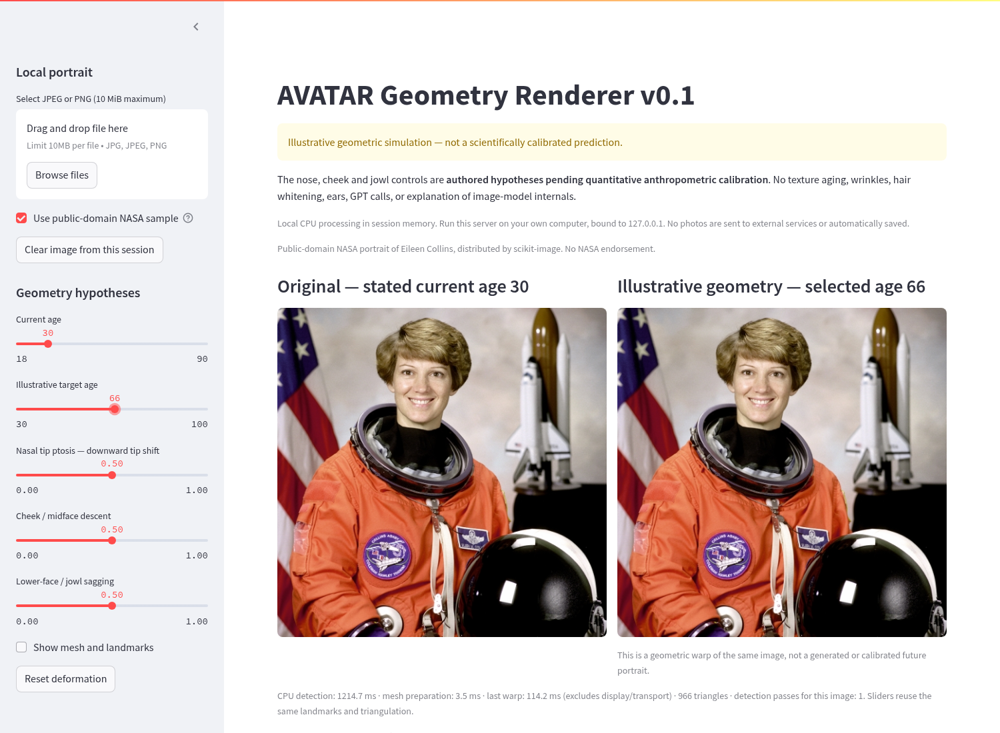
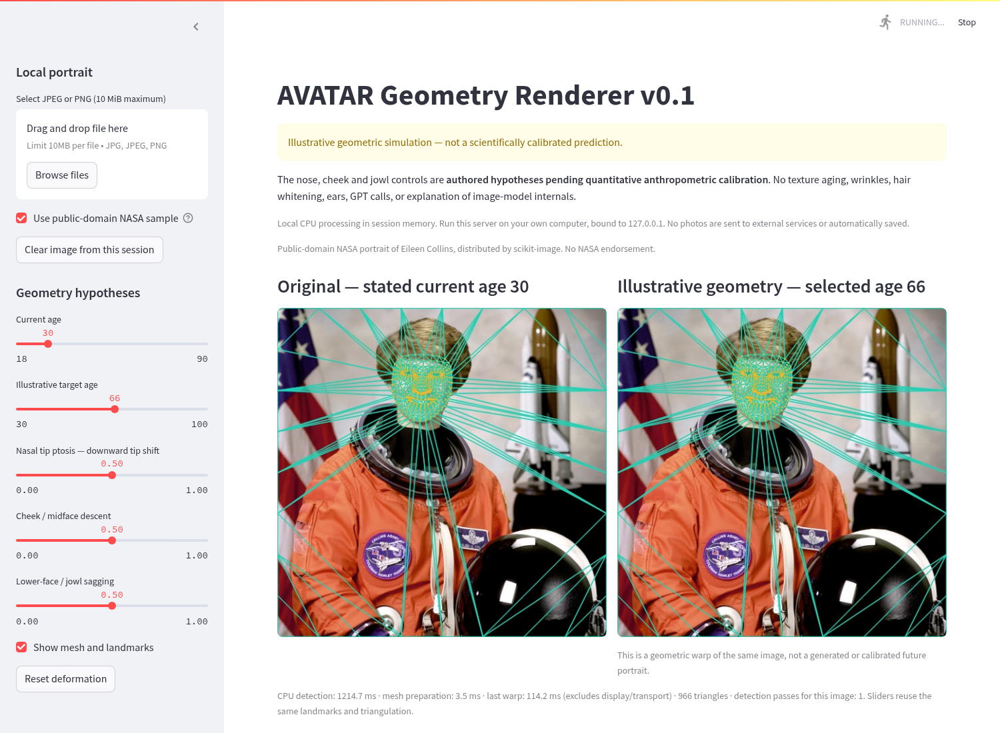

# AVATAR Geometry Renderer v0.1

Standalone CPU demo for [Issue #4](https://github.com/Falconas11/AVATAR/issues/4).
**Illustrative geometric simulation, not a scientifically calibrated prediction.**
The three controls are authored hypotheses pending quantitative anthropometric
calibration. This is a locally warped photograph, not a generated future portrait.
No diffusion, GPT, cloud processing, texture aging, wrinkles, hair whitening,
or external ears. No production API, Box, consent, IRB, or deployment integration.

## Install and launch

Run from the repository root in the existing checkout on your own computer.
Use **64-bit Python 3.11** in a separate virtual environment; do not install these
requirements into the production API environment. Package installation requires
Internet access; runtime uses MediaPipe models already bundled in its pinned
wheel and needs no credentials or Internet connection.

Linux (tested on x86-64):

```bash
python3.11 -m venv experiments/geometry_renderer/.venv
experiments/geometry_renderer/.venv/bin/python -m pip install -r experiments/geometry_renderer/requirements-linux-py311.lock
experiments/geometry_renderer/.venv/bin/python -m experiments.geometry_renderer.launch
```

Windows PowerShell (commands provided, Windows runtime not tested here):

```powershell
py -3.11 -m venv experiments/geometry_renderer/.venv
.\experiments\geometry_renderer\.venv\Scripts\python.exe -m pip install -r experiments/geometry_renderer/requirements.txt
.\experiments\geometry_renderer\.venv\Scripts\python.exe -m experiments.geometry_renderer.launch
```

The launcher prints the local address and binds **only to 127.0.0.1**, port 8501.
Open that address on the same computer. `--port 8502` selects another local port.
It disables Streamlit usage telemetry and file watching, sets the upload cap to
10 MiB, limits OpenCV to one thread, and keeps default XSRF/CORS protection.
On minimal Linux installations OpenCV may require the OS `libgl1` and
`libglib2.0-0` libraries. No GPU, CUDA, model download, or API key is required.

`requirements.txt` pins direct dependencies for supported platforms;
`requirements-linux-py311.lock` records all 59 resolved versions validated here.
MediaPipe **0.10.21** deliberately uses the bundled-model Solutions API. Do not
upgrade it to a different API/model distribution without updating and testing
the detector. See [third-party licenses and model provenance](THIRD_PARTY.md).

## Use the demo

1. Select a local JPEG/PNG with one clearly visible, approximately front-facing
   face, or tick **Use public-domain NASA sample**. The sample is not an AVATAR
   participant; its license/provenance is [documented here](tests/fixtures/README.md).
2. Set current age and illustrative target age. Current ages 18–90 and target
   ages from current age to 100 are supported. Equal ages produce exact identity.
   These are slider parameters, not an estimate of the subject's actual age.
3. Independently adjust **nasal tip ptosis**, **cheek/midface descent**, and
   **lower-face/jowl sagging**. Zero strengths return the original pixels exactly.
4. Toggle the mesh/landmarks to inspect the mapping on both images. Original and
   warped views stay side by side. **Reset deformation** sets strengths to zero,
   target age to current age, and disables the overlay without detecting again.
5. **Clear image from this session** clears the selected source and retained
   processing state. Selecting new content replaces the old mesh.

JPEG/PNG contents must match their extension, be nonempty, ≤10 MiB, have at least
64 pixels per side, and contain ≤16 million pixels. Animated PNGs are rejected.
EXIF orientation is applied, metadata is discarded, RGB output is resized to at
most 960 pixels on its longest side. No usable face, multiple detected faces,
clipped/tiny faces, and degenerate meshes produce informative errors.

### Privacy boundary

The browser sends selected bytes **only to the local loopback Streamlit process**.
They remain in the browser/Streamlit session and renderer memory. There is no
photo-processing API, external upload, photo cache shared between sessions,
filesystem photo write, download button, or automatic output export. Do not run
this server remotely or expose it publicly. Closing/clearing releases references,
not guaranteed secure memory erasure; OS swap/browser memory behavior is outside
this demo's control. Upstream libraries can print generic initialization warnings
but application logs contain no photo data or input filenames/paths.

This tool does not authorize participant data collection and must not be wired
into the research pipeline without a separate reviewed change. Only the explicitly
licensed fixture is used to create the committed screenshots.

## Geometry and safety

`core.py` exposes the pure field and mesh functions. The unrefined MediaPipe
468-point topology is explicit in `REGIONS`:

| Hypothesis | Landmark anchors | Maximum authored downward shift | Compact field radius |
|---|---|---|---|
| Nose tip ptosis | 1, 2, 4 | 0.012 × detected face height | 0.18 × detected face width |
| Cheek/midface descent | 50, 101, 205, 280, 330, 425 | 0.018 × face height | 0.28 × face width |
| Lower-face/jowl sagging | 172, 136, 150, 397, 365, 379 | 0.022 × face height | 0.25 × face width |

These **unitless visual design parameters are not millimeters-per-decade rates**
and are not empirical evidence. Strength multiplies each compact Wendland C2
field; overlapping anchors use the smooth bounded union `1 − ∏(1 − kernel)`
rather than summing peaks or introducing a hard maximum. An illustrative `min((target_age-current_age)/60, 1)` age fraction scales
the requested displacement. The number 60 is a UI normalization choice, not a
biological rate. Regions add together where their fields overlap.

MediaPipe detection and SciPy Delaunay triangulation run once per selected content
hash. This session-local state has no disk/global photo cache. The mesh adds 32
fixed image-boundary anchors. On every slider event, the whole field is backtracked
until every triangle retains positive orientation and at least 10% of its source
area, and all coordinates stay in bounds. If no safe step is found, identity is
returned. The UI reports an applied safety scale below 1; safety clipping can make
combined slider effects nonlinear.

Inverse affine maps use shared barycentric coordinates at triangle edges, with a
single OpenCV `remap` to sample RGB pixels. This avoids mask holes, overlap blends,
and different interpolation on shared edges. Incomplete coverage is rejected.
Authored displacement, not triangulation itself, creates the visual change.

## Tests and measured performance

From the repository root with this virtual environment's Python:

```bash
python -m pytest experiments/geometry_renderer/tests -q
python -m experiments.geometry_renderer.benchmark --iterations 20 --size 512
python -m experiments.geometry_renderer.benchmark --iterations 20 --size 960
```

Validation on 2026-10-22: **34 tests passed**, including pixel-exact identity,
strength/age scaling, bounded coordinates, pinned image borders, positive triangle
areas, full inverse-map coverage, real MediaPipe single/no/multiple faces, corrupt
and oversized images, orientation/resize, session reuse, and Streamlit AppTest
controls/reset/clear. The existing main-branch `tests/` suite also passed (3 tests)
in its original environment; production dependencies were not changed.

CPU: AMD EPYC 9V74, Linux x86-64/glibc 2.41, Python 3.11.17; 5 logical CPUs visible,
cgroup quota equivalent to 4 CPUs. OpenCV and OpenBLAS were set to one thread for
the benchmark; MediaPipe uses its own CPU worker threads. Public-domain NASA
fixture, 966 triangles, full strengths, 20→80 illustrative age interval,
3 warmups followed by 20 warp/overlay measurements; detection has 5 warm samples.

| Measurement | 512 × 512 | 960 × 960 |
|---|---:|---:|
| First detection, including lazy imports | 1166 ms | 1150 ms |
| Warm detection p50 / p95 | 17.8 / 20.4 ms | 19.8 / 25.8 ms |
| One-time mesh preparation | 2.7 ms | 4.6 ms |
| Cached-landmark warp p50 / p95 | **69.6 / 80.8 ms** | **106.4 / 122.9 ms** |
| Overlay p50 / p95 | 2.0 / 2.7 ms | 3.1 / 4.6 ms |

[Raw 512 results](benchmarks/linux-512.json) · [Raw 960 results](benchmarks/linux-960.json).
These are server compute timings, not browser frame rates. An observed local
Chromium run took ~0.81 s for one slider's complete Streamlit/browser round trip;
initial page + first sample ~3.13 s (warm-process repeat ~1.63 s). Streamlit reruns,
image encoding/transport and browser rendering dominate that extra latency.
Performance varies by machine and input; no continuous real-time guarantee.

Optional real-browser validation, with Playwright/Chromium installed and the demo
running at the default local port:

```bash
node experiments/geometry_renderer/tests/browser_smoke.cjs
```

`CHROMIUM_PATH` overrides the script's `/usr/bin/chromium` default. It verifies a
rendered sample, slider update, cached detection, overlay, reset, clear, corrupt
file handling, no browser exceptions, and **zero external browser requests**.
It intentionally regenerates only the two licensed-fixture screenshots below.
Browser dependencies are not part of the production or Python demo requirements.

## Limitations

- Only conservative 2D downward displacement, not 3D anatomy, calibrated aging,
  medical advice, or a forecast. Tilt/pose, hair, expression and occlusion can
  produce implausible changes; use frontal well-lit images.
- Detection is fallible. Exactly one **detected usable** face is required; this
  cannot certify that no other small/occluded face is in the photo. Far-away faces
  can be missed or yield “no usable face”; no demographic accuracy claim is made.
- Landmark noise, changing triangle gradients and interpolation can soften pixels
  or move nearby background. Fixed borders and non-inversion ensure a valid map,
  not anatomical truth or perfect visual quality.
- Face Mesh does not reliably represent external ears. No ear controls or
  appearance/texture synthesis are included.
- Memory and image dimensions are bounded at input; clearing is not secure erasure.
  Windows commands are documented but only Linux execution was validated.
- No live research photos, Box operations, generation services, API/deployment
  changes, or research consent/IRB changes were used for this experiment.

## Screenshots

Explicitly captured from the public-domain NASA fixture, never participant photos.




## Files

- `core.py`: region indices, authored fields, mesh validation, inverse map, overlay.
- `detection.py`: bounded JPEG/PNG decode and offline CPU MediaPipe detection.
- `session.py`: per-session in-memory detection/triangulation reuse.
- `app.py`, `launch.py`: local Streamlit UI and loopback-only launch settings.
- `requirements*.txt` / `*.lock`, `THIRD_PARTY.md`: isolated dependencies/provenance.
- `tests/`: pure functions, real detector, session/UI validation, licensed fixture,
  optional Chromium smoke test.
- `benchmark.py`, `benchmarks/`, `screenshots/`: reproducible timing evidence and
  explicitly generated licensed-demo screenshots.
