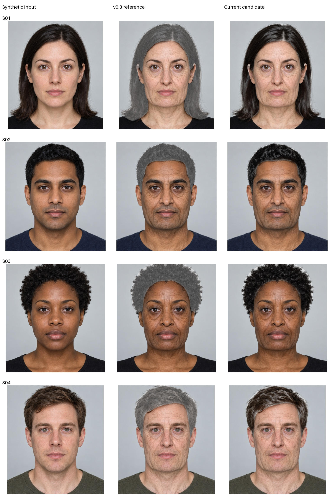

# Naturalness iterations — fictional fixtures only

**Current v0.4.2:** [hair/skin refinement and matched v0.4.1 comparison](balanced_v042/README.md).

**v0.4.1 update:** the historical D hair algorithm is superseded by conservative
tonal gray with bright-outlier and boundary protection. See
[hotfix comparison](hair_hotfix_v041/contact-sheet.jpg) and
[deliberately leaky-mask regression](hair_hotfix_v041/warm-boundary-regression.png).
These diagnostics do not use the user’s uploaded portrait.

Four matched inputs, stated source age30 → illustrative target75, ultra neural
proposal, default geometry/skin/hair controls and no per-input tuning. These are
program outputs, not image-generator aging edits. Baseline is `synthetic_v03`.

| Round | Decision | Visual inspection |
|---|---|---|
| strand_hair_A | Rejected | Hard random lock selection produced a speckled gray wig. |
| balanced_B | Intermediate | Softer source-relative gray, stronger cheek/jaw contour, attenuated fine skin residual. Hair too dark. |
| balanced_C | Rejected hair variant | Brighter locks still looked mottled when enlarged. |
| source_locks_D | v0.4.0 default (superseded) | Gray anchored to existing illuminated strands; weak smooth random variation. Retains dark locks/shadows, less uniform gray veil. |



The chosen contour uses more cheek narrowing and lower-face outward/downward
movement, with unchanged triangle safety checks. Learned skin transfer retains
broad shading and mid-scale furrows while reducing the finest residual by40%.
These are authored hypotheses, not anatomical measurements. Source graph mappings
and provisional status remain unchanged; no neural-internals explanation is claimed.

**Inspection limitations:** D is more conservative about whitening. Hair remains
2D recoloring, not follicle rendering, and cannot reconstruct hidden scalp or
change hairstyle naturally. Eye regions can look tired; skin can remain dry or
papery. Perceived age varies. Four generated faces are neither a perceptual age
study nor demographic/identity validation. No claim of natural or exact75-year
prediction is established by these comparisons.

Each report records code digests and mesh safety scale. Iteration timings can
include cached proposals (earlier rounds) or concurrent inference workloads and
are **not comparable end-to-end benchmarks**. No RTX4060 measurement was made.
The interactive app continues to save no portraits; only this explicit diagnostic
writes these manifest-pinned synthetic fixtures.

Reproduce one candidate using the current code:

```bash
AVATAR_SYNTHETIC_CACHE=/tmp/avatar-synthetic-cache python -m experiments.geometry_renderer.iterate_naturalness --name review
```

The proposal cache key includes model/input hashes, age/quality and prepared image
and landmark bytes. This reuses the neural proposal only; every geometry, mask,
skin and hair composition runs again. Historical images preserve rejected ideas;
rerunning an old round name with current code does not recreate its old algorithm.

`balanced_C_endtoend` preserves an additional intermediate C run at targets60/75:
all8 outputs completed. It ran concurrently with D inference/browser checks, so
its timings must not replace the isolated baseline performance report. D was
also run once without proposal caching (26.4–39.6s/photo under contention) before
a cached repeat to record the final source digest. The report explicitly marks
cache hits; cached post-composition timings exclude neural inference. CPU budget
was relaxed by the user; this is not evidence of a20-second laptop guarantee.

Verification for the selected variant: full Python experiment suite and real
Chromium regression; the latter covers default render, wipe, equal-age reset,
clear, zero external requests and no browser errors. The tests also exposed and
fixed a textureless-hair regression: flat confident hair now receives conservative
neutralization instead of silently skipping aging. Mask confidence continues to
mean segmentation confidence, not a prescribed fraction of gray hair.
