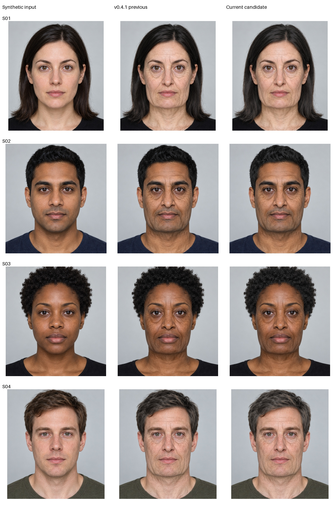
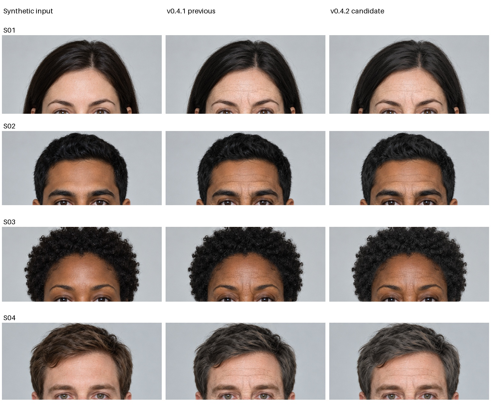

# v0.4.2 matched hair and skin refinement

Four hash-pinned fictional inputs; identical30→75 age controls, ultra proposal,
geometry.65, skin/hair1, no lifestyle modifiers and no per-image tuning. Existing
neural proposals are reused explicitly; geometry/skin/surface/hair composition was
rerun. Iteration times exclude age-model inference and are not laptop benchmarks.





## Selected changes

- Shadow-preserving, smooth ash-gray tonal lift, capped below24 effective
  luminance levels before rounding. Retains the v0.4.1 boundary and bright-outlier
  guard; no random patches, invented strands or highlight selection. Black
  shadows remain black. More visible on dark hair than the<9-level hotfix.
- Learned skin residual fine-detail attenuation increases from40% to60% and a
  smooth45-level tanh limiter reduces extreme creases instead of hard clipping.
- When learned detail is present, added procedural texture uses25% and extra
  eye-shadow proxy55% of the previous gains. Avoids stacking a full grain/
  source-detail boost and another full eye shadow on an already-aged proposal.
  Procedural-only diagnostics retain their original behavior.

Manual inspection finds a softer/less dry surface and more visible diffuse gray
than v0.4.1, without returning to the older bright selected patches. Effects remain
modest; hair can look matte/desaturated, eye regions can still look tired, and the
face still looks synthetic in places. This does not establish natural elderly
hair, exact75-year appearance, identity fidelity or clinical accuracy. Original
mask mistakes, messy fringe, lighting and real-world generalization remain risks.
No user/participant portrait was used as a fixture or published artifact.

All4 mesh safety scales1.0. Full160 experiment tests passed, including deliberately
leaky warm wall/forehead-mask protection, unchanged uncertain flyaways, exact
zero-strength/age identity, bounded visible dark-hair lift, black-shadow protection,
reduced learned/procedural grain stacking and unchanged lifestyle gates. Existing
API tests:3 passed. Browser regression checks age/scenario caching and reset/clear.

Reproduce:

```bash
AVATAR_SYNTHETIC_CACHE=/tmp/avatar-synthetic-cache python -m experiments.geometry_renderer.iterate_naturalness --name review --reference v041
python -m pytest experiments/geometry_renderer/tests -q
```

Original graph CSVs, research/consent/IRB/Box/deployment, model assets and runtime
dependencies are unchanged. This is a repository iteration, not a new hosted app.
