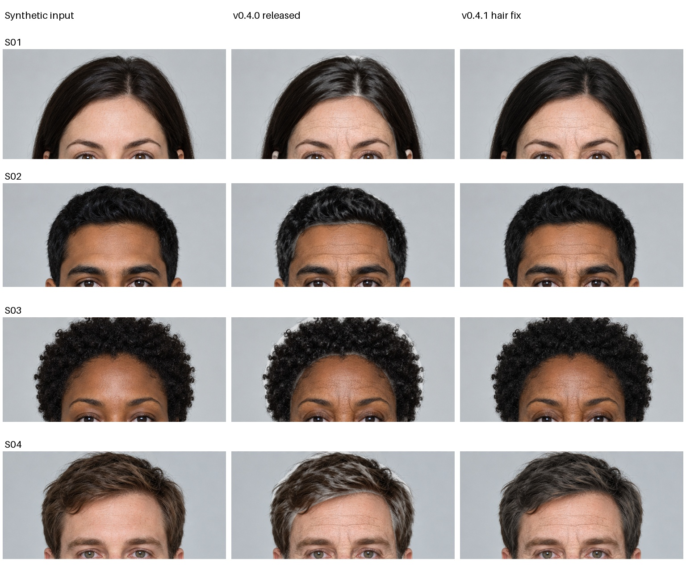
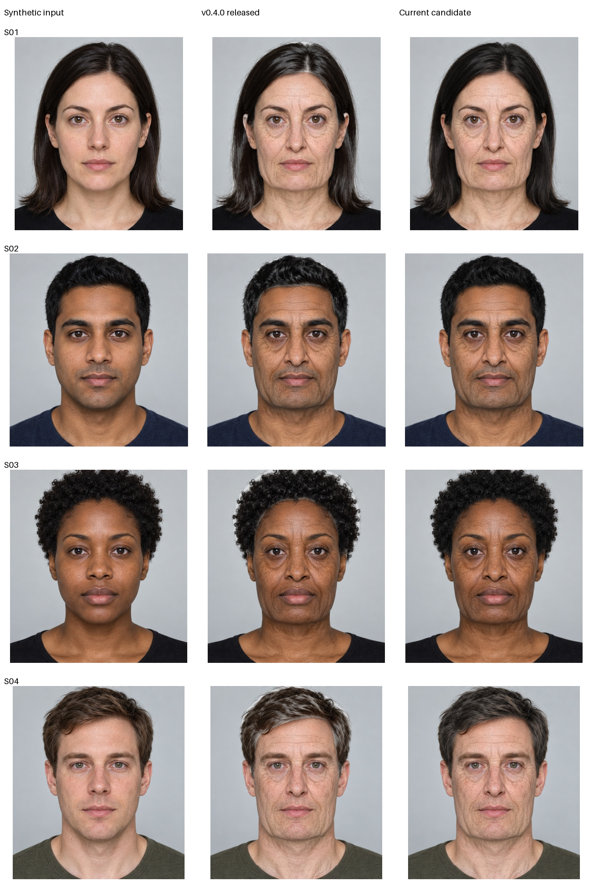

# Hair review: input / released v0.4.0 / v0.4.1

Four manifest-pinned fictional inputs, same stated30→75 age controls, ultra
proposal, geometry.65 and skin/hair1; no per-image tuning or lifestyle modifiers.
The shared neural proposals were reused from the explicit fixture cache. Hair
and the rest of the composition were actually rerun; timings exclude inference.





Manual inspection: the current conservative neutralization avoids the pronounced
silver patch selection seen in the old middle column. Original dark strands and
boundaries are retained more closely. The tradeoff is substantial: especially on
black hair this can now look largely unchanged, with weak visible graying. This
is an artifact-reduction hotfix, not convincing follicle-level elderly hair.
Face/skin naturalness was not improved in this comparison.

All4 rendered at geometry safety scale1.0. No obvious new bright rim was observed
in these4 clean test portraits. They do not reproduce the user's exact messy
fringe/warm-bedroom input and cannot prove that every real input is repaired.
The separate authored leaky-mask regression tests that specific failure mechanism;
no real participant or user-uploaded portrait is used here.

Reproduce from the repository's isolated environment:

```bash
AVATAR_SYNTHETIC_CACHE=/tmp/avatar-synthetic-cache python -m experiments.geometry_renderer.iterate_naturalness --name review --reference v040
```

`report.json` records source digests, proposal cache usage and per-image hair
metrics. Pixel counts and mesh safety do not establish visual naturalness or age.
