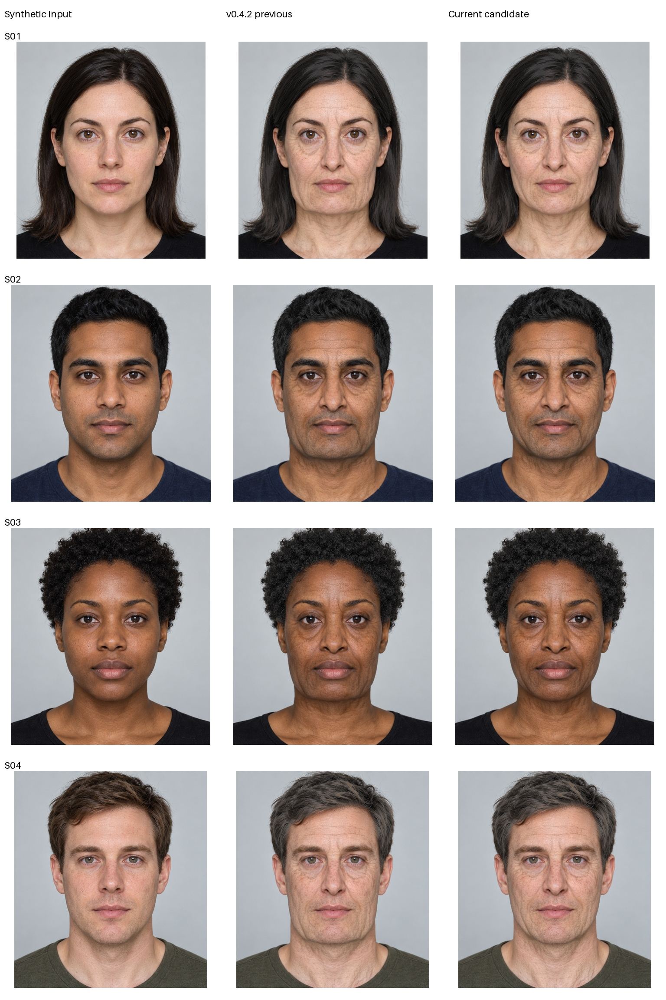

# v0.4.3 source-shape naturalization

Matched fictional inputs,30→75, ultra appearance, geometry.65, skin/hair1,
no lifestyle modifiers or per-image tuning. Shared neural proposals are reused;
source frame, geometry, warped appearance/masks and composition actually rerun.
Timings exclude age-model inference. Original / v0.4.2 / v0.4.3:



The old outward-jaw plus inward-cheek combination is removed. Local descent and
hollowing are reduced, source tilt is respected and a source-relative contour
safeguard is applied before triangle checks. All4 mesh and shape-guard scales1.0
in this batch. The measured jaw/cheek ratio changes about0.4–0.6%, retaining source
variation rather than applying a common square-jaw target. Ratios are landmark
proxies, not bone measurements or physiological aging estimates.

Manual inspection finds less lower-face broadening and a silhouette closer to
the original while retaining skin/hair aging cues. No claim of exact target75,
naturalness or biometric identity accuracy. Skin/hair/model limitations remain;
these4 clean faces do not establish generalization to real portraits or poses.

[Dataset review and licensing](../../../research/FACE_DATASETS.md):5 official
project READMEs reviewed, no dataset images downloaded and no model retrained.
The shape bounds are authored safeguards, not dataset-calibrated anatomy.

Reproduce:

```bash
AVATAR_SYNTHETIC_CACHE=/tmp/avatar-synthetic-cache python -m experiments.geometry_renderer.iterate_naturalness --name review --reference v042
```

`report.json` includes source hashes and source/requested/guarded/rendered ratios.
