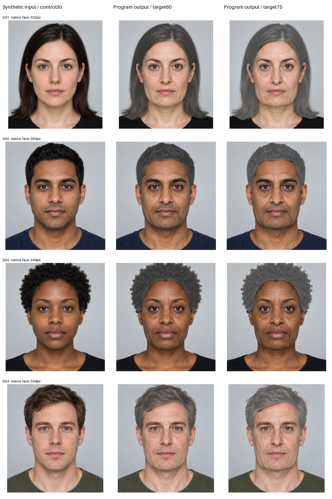

# Four matched synthetic-portrait comparisons

All four baseline inputs are generated fictional adults; no real-person or
participant photographs are used. Image generation created **inputs only**.
All eight aged outputs were produced by the repository program, with no per-image
parameter tuning or generated older reference.

[Full contact sheet](contact-sheet.jpg): columns are input/control30, program60,
program75. Every row uses the same source-based crop and display scale for all
three panels. Original source pixels and exact outputs are included separately.

| Input | Native face height | Input scale | Target60 render | Target75 render |
|---|---:|---:|---:|---:|
| S01 | 332.4px | 1.0 | 13.534s | 13.224s |
| S02 | 350.1px | 1.0 | 14.108s | 13.623s |
| S03 | 344.2px | 1.0 | 13.066s | 13.612s |
| S04 | 344.4px | 1.0 | 12.559s | 12.441s |

All inputs are627×627; no working-image upsampling was needed. Shared settings:
source-age control30, targets60/75, nine-window ultra skin, geometry strengths.65,
skin/hair strengths1, zero UV/smoking modifiers, all mechanism controls1. The
controls are not estimates of a real person's age. Source detection and semantic
parsing run once per input; appearance is recomputed for each requested target.

## Observations

- All4 portraits and8 requested outputs completed; no input was silently skipped.
- Wrinkles/texture and eye/mouth/neck changes are more inspectable than in the
  old ~100-face-pixel NASA reference. The original mouth/eye appearance remains
  recognizable, but this is visual inspection, not an identity-metric guarantee.
- Target75 generally has stronger aging cues than60 under unchanged settings.
  This does not validate exact perceived age or a real individual trajectory.
- Graying can still look like broad desaturation rather than varied individual
  gray strands, especially on short/curly hair. Some skin appears dry/papery or
  overly contrasty; under-eye darkening may read as fatigue rather than aging.
- These4 synthetic examples are not a broad real-photo/demographic benchmark.
  Controlled studio lighting does not test occlusion, pose or everyday cameras.

`report.json` records hashes, controls, crop bounds, per-stage output diagnostics,
counts and timings. Times are this cloud CPU run, not the user's laptop.

To reproduce after installing dependencies and verified model assets:

```sh
python -m experiments.geometry_renderer.validate_synthetic_batch --quality ultra
```

The script accepts only the included manifest-verified synthetic fixtures and
writes these images only when explicitly invoked. Interactive uploads remain
memory-only. The original generated2×2 chart and its crop bounds/digest are
identified in `tests/fixtures/synthetic_portraits/manifest.json`.


